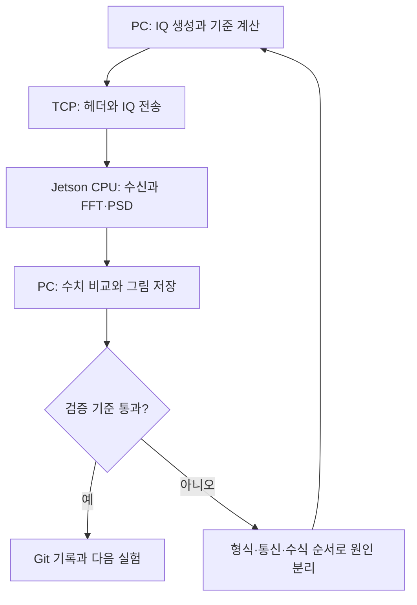

# 00. 시작 안내 — 하나의 무선 DSP 개발 과정을 끝까지 경험하기

> 저장소 반영 (2026-10-30): 이 교재와 코드는 저장소의 `jetson/` 폴더에 있습니다. 교재의 명령은 모두 clone 한 저장소의 `jetson/` 폴더(`cd wireless-dsp-learning-hub/jetson`)에서 실행합니다. MATLAB 24주 트랙은 `../matlab/` 입니다.

이 과정의 첫 결과물은 **PC가 만든 복소 IQ를 Jetson Nano 2GB로 보내고, Jetson의 C++ 프로그램이 FFT·PSD를 계산한 뒤 PC에서 정답과 비교하는 시스템**입니다. 신호처리 수식, 메모리 배열, 바이트 통신, 리눅스 실행, 오류 분석, Git 이력을 하나의 실험으로 연결합니다. 개인 학습용 프로젝트이며 실제 안테나 수신 장비나 산업용 방향탐지 시스템의 성능 검증은 아닙니다.

기존 24주·72세션은 주제 찾기용 인덱스로 계속 사용합니다. 몇 주에 끝낼지는 정하지 않습니다. 설명할 수 있고, 직접 실행했으며, 고의로 고장 낸 뒤 원인을 찾아 복구했다면 다음 단계로 갑니다. Notion 게시 완료와 본인의 학습 완료는 서로 다른 상태입니다.

## 먼저 알아둘 범위

Jetson에는 이번 실습에서 사용할 RF 수신기/ADC가 없습니다. 따라서 PC의 수학 모델이 ADC 역할을 대신합니다. LAN으로 전달하는 것은 전파가 아니라 숫자로 된 IQ 샘플입니다. 추가 SDR·FPGA·카메라 보드는 필요하지 않습니다. 전원, microSD, LAN 케이블은 보드 구동에 필요한 기본 구성품입니다. 대형 LLM을 Nano에 설치하는 것은 첫 목표에 포함하지 않습니다. 나중에 PC/서버의 LLM을 문서 검색·실험 설명에 연결할 수 있습니다.

## 읽는 순서와 단계별 산출물

| 순서 | 문서 | 해야 할 일 | 다음 단계로 가는 기준 |
|---|---|---|---|
| 0 | 이 문서 | 전체 입력과 출력을 자신의 말로 설명 | PC/Jetson/통신의 역할 구분 |
| 1 | [01 환경](01-system-setup.md) | 부팅·SSH·도구 확인 | 보드 모델·OS·IP·컴파일러 기록 |
| 2 | [02 수식](02-iq-fft-psd.md) | IQ·FFT·PSD 예상값 계산 | 3 kHz, 진폭 1, 전력 1 설명 |
| 3 | [03 통신 명세](03-protocol.md) | 24바이트 헤더와 payload 해석 | 2채널 2048샘플의 32768바이트 계산 |
| 4 | [04 전체 실행](04-build-run-code.md) | CPU 서버/클라이언트 실행 | Python 자동 비교 PASS |
| 5 | [05 검증·디버깅](05-validation-debug.md) | 분할·잘림·잘못된 헤더 재현 | 실패 후 서버가 다시 요청 처리 |
| 6 | [06 Git 관리](06-git-github.md) | branch→commit→push→검토 | README만 보고 재현할 commit 확보 |
| 7 | [07 심화 DSP](07-advanced-dsp.md) | 상태 FIR·공분산·MUSIC 실험 | 가정과 실패 조건까지 설명 |
| 8 | [08 실시간·최적화](08-streaming-performance.md) | 큐·지연·GPU 확장 설계 | 병목 수치와 보존 정책 명시 |
| 9 | [09 기존 과정 연결](09-wireless-roadmap.md) | QPSK→OFDM→NR→RT→ISAC | 교육모델과 실제 모델 경계 표시 |
| 10 | [10 프로젝트 운영](10-project-rules-sources.md) | 실험 명세·AI 지침·출처 관리 | 재현 가능한 최종 보고서 |

## 어떤 파일이 어떤 종류의 코드인가

| 파일 | 종류 | 실행 위치 | 역할 |
|---|---|---|---|
| `labs/edge_dsp/cpp/server.cpp` | C++11 소스 | Jetson/Linux | 직접 작성한 radix-2 FFT, TCP 서버 |
| `labs/edge_dsp/python/client.py` | Python 3.6+ | Windows PC 또는 Linux | 표준 라이브러리만으로 IQ 생성·전송·검증 |
| `labs/edge_dsp/matlab/run_edge_client.m` | MATLAB 함수 | MATLAB 설치 PC | 같은 프로토콜, 기준 FFT 비교·그래프 |
| `labs/edge_dsp/tests/test_transport.py` | Python unittest | Linux | 실제 C++ 서버를 띄운 통합시험 |
| `labs/edge_dsp/python/advanced_dsp.py` | Python+NumPy | PC/Jetson | FIR·MUSIC·FFT 공분산 실험 |
| `labs/edge_dsp/matlab/qpsk_ofdm_reference.m` | MATLAB 함수 | PC | QPSK BER와 무잡음 OFDM 기준선 |
| `docs/edge-dsp/*.md` | Markdown | Notion/GitHub/VS Code | 교재·설계서·실행 절차 |

**코드 읽는 법:** 먼저 입력 배열의 크기와 단위를 적습니다. 다음으로 함수 호출 순서를 따라가고 마지막으로 오류 처리를 읽습니다. 한 줄을 바꿀 때는 그 줄이 바꿀 관찰값을 먼저 예측합니다. 결과만 보고 맞았다고 판단하지 않습니다.

## 현재 검증 범위

새로 제공한 C++ 서버와 Python 실습은 Linux x86_64 환경에서 실제 빌드·실행했습니다. TCP 통합시험 6개와 FIR/MUSIC 실험을 통과했습니다. Jetson ARM64, Windows Python, MATLAB 실행은 사용자의 장비에서 추가 확인해야 합니다. 기존 자료의 R2025b 검증 설명을 새 코드에 그대로 적용하지 않습니다. 상세 결과는 [검증 기록](verification.md)에 있습니다.

첫 실행이 끝나면 본인 학습 기록에 `내 환경 / 실행 명령 / 예상값 / 실제값 / 오류 / 원인 / 수정 commit / 남은 질문`을 남기세요. 시간 대신 이 기록이 학습 진도를 결정합니다.
