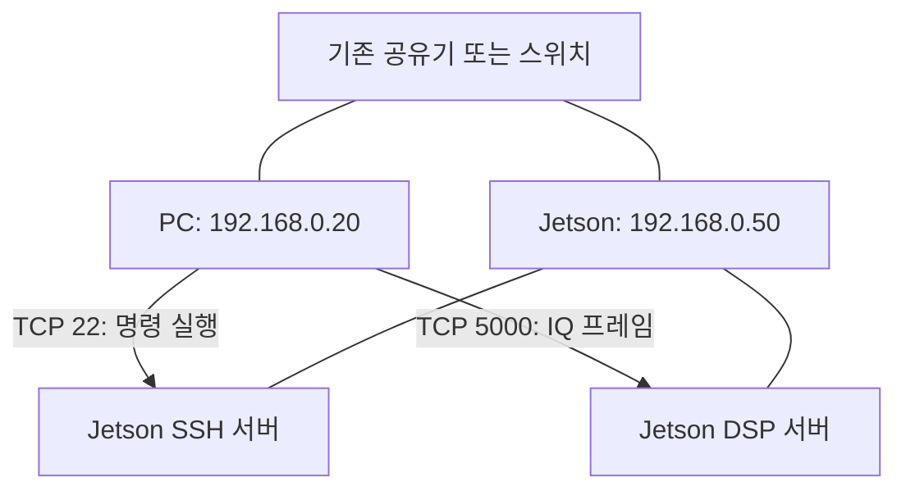

# 01. PC·Jetson·LAN의 역할과 최초 설치

## 1. 필요한 물건과 프로그램

| 구성 | 필요한 이유 | 이 과정의 선택 |
|---|---|---|
| Jetson Nano 2GB Developer Kit | Linux에서 별도 DSP 프로세스 실행 | 보유한 개인 학습 보드 |
| USB-C 5 V / 3 A 전원 | 보드에 안정적으로 전원 공급 | PC USB 데이터 케이블과 구분 |
| microSD | 운영체제와 프로그램 저장 | NVIDIA 최소 32 GB, 2GB 모델은 64 GB 이상 권고 |
| LAN 케이블 | PC와 Jetson 사이 데이터 이동 | 기존 공유기/스위치에 각각 연결 |
| Windows PC | 편집·신호 생성·분석 | Git Bash, VS Code, Python; MATLAB은 선택 |
| GitHub Desktop | Git을 화면으로 조작 | Git Bash와 같은 저장소에서 택일 가능 |
| SSH | Jetson의 터미널을 PC에서 열기 | 실제 프로그램은 Jetson에서 실행 |

PC와 Jetson이 같은 LAN에 있으면 로컬 실습은 인터넷 없이도 통신할 수 있습니다. 최초 설치·패키지 다운로드·GitHub 동기화에는 인터넷이 필요합니다. PC와 Jetson을 직접 LAN 케이블로 연결하는 경우 DHCP가 없을 수 있으므로 주소를 수동 설정해야 합니다.

Nano 2GB의 USB-C는 전원 입력입니다. Micro-USB는 초기 headless 설정/장치 연결에 사용합니다. **USB-C 연결만으로 PC와 IQ 통신이 된다고 가정하지 않습니다.** 첫 실습은 RJ45 LAN을 사용합니다. Micro-USB를 통한 초기 설정은 NVIDIA 공식 절차에 따라 Windows 장치 관리자의 COM 포트를 찾고 터미널로 접속합니다.

## 2. 운영체제 선택부터 확인

Nano는 Orin Nano와 다른 제품입니다. NVIDIA 자료상 Nano는 JetPack 4 계열을 사용하며 4.6.6이 해당 계열 최종 릴리스입니다. JetPack 5/6/7 또는 최신 데스크톱 CUDA 설치 명령을 Nano에 그대로 적용하지 마세요. 공식 **Nano 2GB용** SD 이미지 안내로 시작하고 실제 설치 버전을 기록합니다. SD 이미지의 버전과 최종 JetPack 번호가 항상 같지는 않습니다.

1. 이미 부팅되는 보드는 먼저 아래 확인 명령을 실행합니다. 학습 코드 때문에 OS를 다시 설치할 필요는 없습니다.
2. 새 microSD라면 공식 Getting Started에서 Nano 2GB 이미지를 선택합니다. 이미지 기록은 선택한 카드 내용을 지우므로 PC 시스템 디스크와 구분합니다.
3. 초기 화면 또는 Micro-USB serial로 사용자 이름·암호·시간대를 설정합니다. 예제의 `jaehak`은 실제 생성한 사용자명으로 바꿉니다.
4. LAN을 연결하고 Jetson 화면/serial 터미널에서 주소를 확인합니다.

```bash
# 이 블록은 Jetson 터미널에서 실행
cat /proc/device-tree/model
cat /etc/nv_tegra_release
cat /etc/os-release
uname -m
hostname -I
ip -br addr
free -h
df -h /
```

`uname -m`의 예상값은 `aarch64`입니다. `hostname -I`는 주소가 여러 개 나올 수 있으므로 실제 LAN 인터페이스 주소를 선택합니다. `192.168.0.50`은 이후 문서에서 쓰는 예시이며 장비의 실제 주소가 아닙니다.

## 3. PC에서 SSH 연결

```bash
# Windows Git Bash 또는 PowerShell에서 실행
ssh jaehak@192.168.0.50
```

최초 연결 시 지문 확인 화면이 나옵니다. 접속 대상이 자신의 Jetson인지 확인한 뒤 등록합니다. 로그인 후 프롬프트가 Jetson 사용자/호스트로 바뀌면 이후 명령은 Jetson에서 실행됩니다. 종료는 `exit`입니다. 로컬 VS Code의 C++ 파일을 바꿔도 Jetson 파일이 자동으로 바뀌지는 않습니다. Git push/pull로 동기화하거나 Remote SSH로 Jetson 파일을 직접 편집해야 합니다.

SSH가 연결되지 않으면 Jetson에서 `systemctl status ssh`로 서버 상태를 확인합니다. 패키지가 없다면 아래 설치 목록에 `openssh-server`를 포함합니다. `ping` 실패만으로 통신 불가라고 단정하지 말고 주소·서브넷·SSH 서비스·방화벽을 순서대로 확인합니다.

```bash
# Jetson: 배포판에서 제공하는 패키지 사용. CUDA 설치 과정이 아니다.
sudo apt-get update
sudo apt-get install build-essential git python3 openssh-server
g++ --version
python3 --version
git --version
systemctl status ssh --no-pager
```

오래된 OS 저장소에서 설치가 실패하면 오류와 OS 버전을 먼저 기록합니다. 임의의 Orin용 저장소나 최신 CUDA 저장소로 바꾸지 않습니다. 첫 TCP 실습에는 pip, NumPy, CUDA, Docker가 필요하지 않습니다.

## 4. 네트워크 예시



| 항목 | 예시 | 적용 위치 |
|---|---|---|
| PC 주소 | 192.168.0.20/24 | Windows 네트워크 설정 |
| Jetson 주소 | 192.168.0.50/24 | Jetson 네트워크 설정 또는 DHCP 할당 |
| 서버 포트 | TCP 5000 | C++ 실행 인자, MATLAB/Python 클라이언트 |
| SSH 포트 | TCP 22 | 원격 로그인 |
| 로컬 시험 주소 | 127.0.0.1 | 같은 컴퓨터 안의 서버/클라이언트 |

서버를 `127.0.0.1`에 bind하면 PC가 접근할 수 없습니다. LAN 실습에서는 Jetson의 실제 LAN IP로 실행합니다. 해당 학습 서버에는 인증/TLS가 없으므로 공유기 포트 포워딩 없이 신뢰하는 로컬 LAN에서 사용합니다. 이는 실제 제공 코드의 운용 범위입니다.

PC의 터미널, Jetson의 SSH 터미널, MATLAB Command Window는 서로 다른 실행 위치입니다. 창 제목/프롬프트를 보고 명령을 넣으세요. `g++`는 Jetson에서 C++를 기계어로 바꾸는 도구이고, `python`과 MATLAB은 각자 스크립트를 실행하는 환경입니다. Git은 파일 버전을 관리할 뿐 컴파일하지 않습니다.

## 5. 이 단계 완료 기준

- 보드 모델·OS·아키텍처·IP를 기록했다.
- PC에서 SSH로 접속하고 종료할 수 있다.
- Jetson에서 `g++`, `python3`, `git` 버전을 확인했다.
- 추가 보드 없이 어느 포트로 숫자가 오가는지 설명할 수 있다.

공식 자료: [Nano 2GB User Guide](https://developer.nvidia.com/embedded/learn/jetson-nano-2gb-devkit-user-guide), [Getting Started](https://developer.nvidia.com/embedded/learn/get-started-jetson-nano-2gb-devkit), [JetPack 4 지원 종료 안내](https://forums.developer.nvidia.com/t/announcing-end-of-life-for-nvidia-jetpack-4-with-the-release-of-jetpack-4-6-6/314300).
