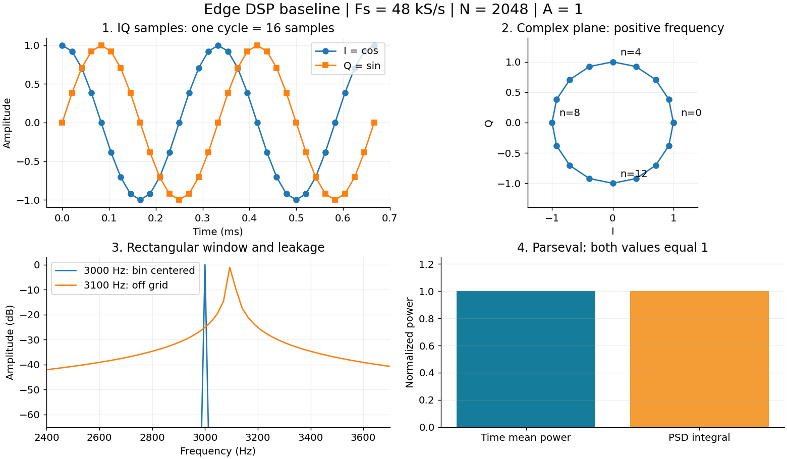

# 02. IQ·샘플링·FFT·PSD를 실제 숫자로 이해하기

## 1. I와 Q는 무엇인가

복소수 `x[n]=I[n]+jQ[n]`는 같은 시각의 두 실수 값을 하나로 묶습니다. 복소 정현파는 다음과 같습니다.

$$
x[n]=A e^{j(2\pi f_0 n/F_s+\phi)}=A\cos(2\pi f_0 n/F_s+\phi)+jA\sin(2\pi f_0 n/F_s+\phi)
$$

I는 코사인 성분, Q는 사인 성분입니다. 복소 평면에서 길이 A의 화살표가 회전한다고 생각하면 됩니다. `f0>0`은 한 방향, `f0<0`은 반대 방향 회전입니다. 실수 신호만 보면 양·음 주파수가 대칭으로 섞이지만, IQ에서는 회전 방향을 구분할 수 있습니다.

Fs=48000 sample/s, f0=3000 Hz이면 한 주기가 16샘플입니다. n=0에서 1+j0, n=4에서 0+j1, n=8에서 -1+j0, n=12에서 0-j1입니다. 여기의 전력은 정규화된 `|x|²`이며 전압·임피던스 보정 없이는 dBm으로 부르지 않습니다.

## 2. N과 Fs가 각각 바꾸는 것

| 변수 | 예시 | 의미 |
|---|---|---|
| Fs | 48000 sample/s | 1초에 얻는 복소 샘플 수 |
| N | 2048 | 한 프레임에서 각 채널의 샘플 수 |
| M | 2 | 동시에 처리하는 채널 수 |
| 관측 시간 N/Fs | 42.6667 ms | 프레임이 나타내는 시간 길이 |
| FFT bin 간격 Fs/N | 23.4375 Hz | FFT 축의 샘플 간격 |
| f0/(Fs/N) | 128 | 3000 Hz의 0-based bin |

bin 간격이 작아졌다고 두 신호가 반드시 분리되는 것은 아닙니다. 실제 분해능에는 관측 시간과 창의 주엽 폭이 함께 관여합니다. zero padding은 축을 촘촘히 보간할 뿐 새로운 관측 정보를 만들지 않습니다.

샘플에서 주파수는 Fs 간격으로 반복됩니다. 예를 들어 복소수에서 f0와 f0+Fs는 같은 샘플입니다. 복소 IQ의 표시 범위는 보통 `[-Fs/2, Fs/2)`입니다. 기본 예제의 두 채널은 공간 배열 신호가 아니라 **+3000 Hz 진폭 1 / -6000 Hz 진폭 0.5**의 독립 검증 채널입니다.

## 3. DFT 정의에서 FFT 출력 읽기

$$
X[k]=\sum_{n=0}^{N-1}x[n]e^{-j2\pi kn/N}
$$

FFT는 이 합을 빠르게 계산하는 알고리즘입니다. 입력이 정확히 bin k0에 놓인 복소 정현파면 k=k0에서 회전이 상쇄되어 N개가 같은 방향으로 더해집니다. 따라서 `X[k0]=N A exp(jφ)`이고 `|X[k0]|/N=A`입니다. 이 코드의 forward FFT는 정규화하지 않고 inverse FFT 쪽에 1/N이 들어가는 MATLAB/NumPy 기본 관례와 맞춥니다.

`k=0...N/2-1`은 비음수 주파수, `k=N/2...N-1`은 `(k-N)Fs/N`으로 해석합니다. MATLAB 배열 인덱스는 1-based이므로 k=128의 배열 위치는 129입니다. `fftshift`는 계산 결과를 바꾸지 않고 표시 순서를 바꿉니다.

## 4. 진폭 스펙트럼과 PSD는 왜 다른가

직사각 창을 쓴 양측 PSD는 다음과 같습니다.

$$
S[k]=\frac{|X[k]|^2}{F_sN},\qquad
\sum_k S[k]\Delta f=\frac{1}{N}\sum_n|x[n]|^2,\quad\Delta f=F_s/N
$$

왼쪽은 주파수별 전력을 합한 값이고 오른쪽은 시간영역 평균 전력입니다. 이 Parseval 관계를 자동 시험에 넣으면 FFT scaling 오류를 찾을 수 있습니다. 단위가 전압이면 V²/Hz, 현재 합성 신호에서는 정규화 전력/Hz입니다. 복소 IQ 양측 PSD에 단측 실수 신호 규칙인 2배를 적용하면 전력이 틀립니다.

| 채널 | peak 주파수 | peak 진폭 | 평균 전력 | peak PSD | PSD 적분 |
|---|---:|---:|---:|---:|---:|
| 0 | 3000 Hz | 1 | 1 | 2048/48000 ≈ 0.0426667 | 1 |
| 1 | -6000 Hz | 0.5 | 0.25 | 0.0106667 | 0.25 |

PSD peak 높이는 N에 따라 달라질 수 있지만 적분 전력은 유지됩니다. `10log10(S)`는 전력의 dB이고 `20log10(A)`는 진폭의 dB입니다. 그림의 -150 dB 바닥은 log(0)을 피하기 위한 표시값이지 계측기의 실제 잡음 바닥이 아닙니다.

## 5. 창을 추가할 때 고쳐야 할 두 정규화

f0=3100 Hz로 바꾸면 bin에 정확히 놓이지 않아 에너지가 주변으로 퍼집니다. 창은 가장자리 불연속을 줄이는 대신 주엽을 넓힙니다. Hann 창을 넣을 때는 PSD에 `Fs*sum(w²)`, bin 중심 진폭에는 `sum(w)`를 사용합니다. 둘을 같은 분모로 쓰지 않습니다.

$$
S_w[k]=\frac{|FFT(xw)[k]|^2}{F_s\sum_n w[n]^2},\quad
A_{\text{bin}}=\frac{|FFT(xw)[k_0]|}{\sum_n w[n]}
$$

창 PSD 적분은 `sum(|xw|²)/sum(w²)`와 정확히 같고, 일반적인 임의 신호의 원래 평균 전력과 항상 동일하지는 않습니다. 서버 v1은 직사각 창으로 고정되어 있습니다. 창 기능을 추가한다면 프로토콜 버전 또는 명시적 설정도 같이 바꾸고 PC 기준 코드와 함께 검증합니다.

## 6. 직접 바꿔 볼 실험과 답

1. 진폭을 1→0.5로 바꾸면 진폭은 절반, 전력은 1/4, dB는 약 -6.02가 됩니다.
2. 주파수를 +3000→-3000으로 바꾸면 peak 위치만 반전되고 전력은 유지됩니다.
3. N=2048→4096에서 관측 시간은 두 배, bin 간격은 절반입니다. Fs가 고정이면 초당 원시 IQ 양은 같습니다.
4. I/Q를 서로 바꾸면 `Q+jI=j*conj(x)`가 되어 주파수 부호가 뒤집힙니다. 주파수 부호가 틀릴 때 볼 지점입니다.
5. Q의 부호만 반전하면 켤레 신호가 됩니다. 배열 위상 부호를 혼동하면 DOA 부호까지 틀릴 수 있습니다.

공식 함수 정의: [NumPy FFT](https://numpy.org/doc/stable/reference/generated/numpy.fft.fft.html). 위 식과 예시 수치는 이 교재의 실험 명세입니다.
