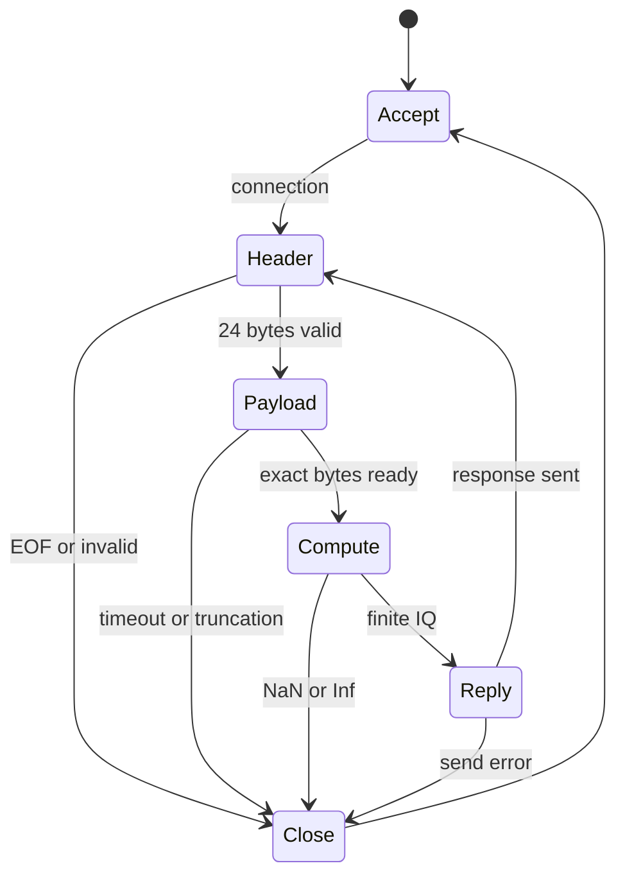

# 03. IQ 프로토콜을 먼저 설계하는 이유

TCP는 순서 있는 바이트 스트림을 제공합니다. `send` 한 번이 `recv` 한 번으로 도착한다는 뜻은 아닙니다. 한 요청이 여러 조각으로 오거나 여러 요청이 한 번에 읽힐 수 있습니다. 그러므로 무엇이 한 프레임인지 송수신자가 합의해야 합니다.

## 1. 실험 계약 v1

| 항목 | 고정값 또는 허용값 | 설계 이유 |
|---|---|---|
| transport | IPv4 TCP, port 5000 | 첫 실습에서 패킷 유실 복구를 TCP에 맡김 |
| magic/version | ASCII `IQ01` | 잘못된 프로그램과 포맷을 구분 |
| integer | uint32 little-endian | MATLAB/Python/C++ 일치 |
| IQ scalar | IEEE754 float32 little-endian | 실수와 허수 각각 4바이트 |
| channels M | 1~16 | 메모리 상한, v1 데모 범위 |
| samples/channel N | 8~16384, 2의 거듭제곱 | 직접 구현 radix-2 FFT 제약 |
| Fs | 정수 1~10,000,000 Hz | 헤더 필드 범위; 실제 처리속도 보장 아님 |
| response | uint32 byte length + UTF-8 JSON | 초보자가 내용을 읽고 비교하기 쉬움 |

## 2. 24바이트 헤더

| byte offset | 길이 | 필드 | M=2,N=2048 예시 |
|---|---:|---|---|
| 0 | 4 | magic | `49 51 30 31` hex = IQ01 |
| 4 | 4 | seq | 1 |
| 8 | 4 | channels | 2 |
| 12 | 4 | samples per channel | 2048 |
| 16 | 4 | sample rate Hz | 48000 |
| 20 | 4 | payload bytes | 32768 |

payload 길이는 `M*N*2*4 = 8MN`입니다. 헤더 포함 요청은 32792바이트입니다. 2048을 little-endian으로 쓰면 `00 08 00 00`, 48000은 `80 BB 00 00`입니다. C/C++ `struct`를 통째로 보내면 padding과 endian 차이가 생길 수 있으므로 코드에서는 필드를 바이트 단위로 읽습니다.

## 3. 메모리 행렬과 전송 순서

수학에서는 `X.shape = M×N`, 행은 채널, 열은 시간입니다. 전송은 sample-major로 **시각 0의 모든 채널 → 시각 1의 모든 채널** 순서입니다.

| float 위치 | 내용 | scalar 예시 |
|---:|---|---:|
| 0 | I(channel0,sample0) | 1 |
| 1 | Q(channel0,sample0) | 0 |
| 2 | I(channel1,sample0) | 0.5 |
| 3 | Q(channel1,sample0) | 0 |
| 4 | I(channel0,sample1) | cos(π/8) |
| 5 | Q(channel0,sample1) | sin(π/8) |

C++의 복소 샘플 시작 offset은 `8*(n*M+ch)`입니다. MATLAB에서는 2M×N 배열에 홀수 행 I, 짝수 행 Q를 넣고 `(:)`로 펼칩니다. Python은 sample을 바깥 반복문, channel을 안쪽 반복문으로 둡니다. NumPy에서 습관적으로 `X.tobytes()`를 쓰면 기본 행 우선 배열과 충돌할 수 있으므로 순서를 명시해야 합니다.

## 4. 수신 상태와 오류 복구

`read_exact`는 필요한 길이만큼 모일 때까지 반복합니다. 0바이트 수신은 정상적인 연결 종료를 뜻합니다. 프레임 도중 종료하면 해당 프레임은 불완전하므로 버립니다. 잘못된 magic/길이/NaN 입력은 연결을 닫고 다음 연결을 기다립니다. v1은 오류 JSON 응답을 제공하지 않으므로 클라이언트에는 EOF로 보이며 서버 stderr에서 상세 원인을 확인합니다.

수신·송신 timeout은 개별 소켓 호출의 5초 대기 상한입니다. **전체 프레임의 절대 마감시간이나 실시간 보장은 아닙니다.** 천천히 계속 바이트를 보내는 상대에게도 전체 5초 제한을 적용하려면 monotonic deadline을 별도로 구현해야 합니다. 지금은 신뢰하는 LAN에서 한 클라이언트씩 처리하는 학습 서버입니다.

## 5. 응답에서 보는 값

`seq`는 요청과 응답 연결용 번호입니다. v1 서버는 순서/중복 정책을 강제하지 않고 그대로 돌려줍니다. `results[ch]`에는 peak_hz, peak_amplitude, mean_power, psd_integral, N개 양측 unshifted PSD 값이 있습니다. `processing_ms`는 payload 해석부터 FFT·통계·PSD JSON 작성까지의 서버 시간입니다. 순수 FFT 시간이 아닙니다. `roundtrip_ms`는 클라이언트에서 측정하며 전송·서버 처리·응답·JSON 해석을 포함합니다.

JSON은 사람이 읽기 쉬운 대신 숫자당 바이트 수가 큽니다. 그래서 이 v1은 한 프레임 요청→결과 확인 방식입니다. 연속 고속 시스템에서는 이진 PSD 또는 peak 요약, 표시율 제한을 검토합니다. IQ는 이진 `.bin`과 Fs/M/N/포맷을 적은 `.json` 메타데이터로 보관하고 CSV는 작은 구간 확인에 씁니다.

공식 참고: [Python Socket HOWTO](https://docs.python.org/3/howto/sockets.html), [MATLAB tcpclient](https://www.mathworks.com/help/matlab/ref/tcpclient.html).
