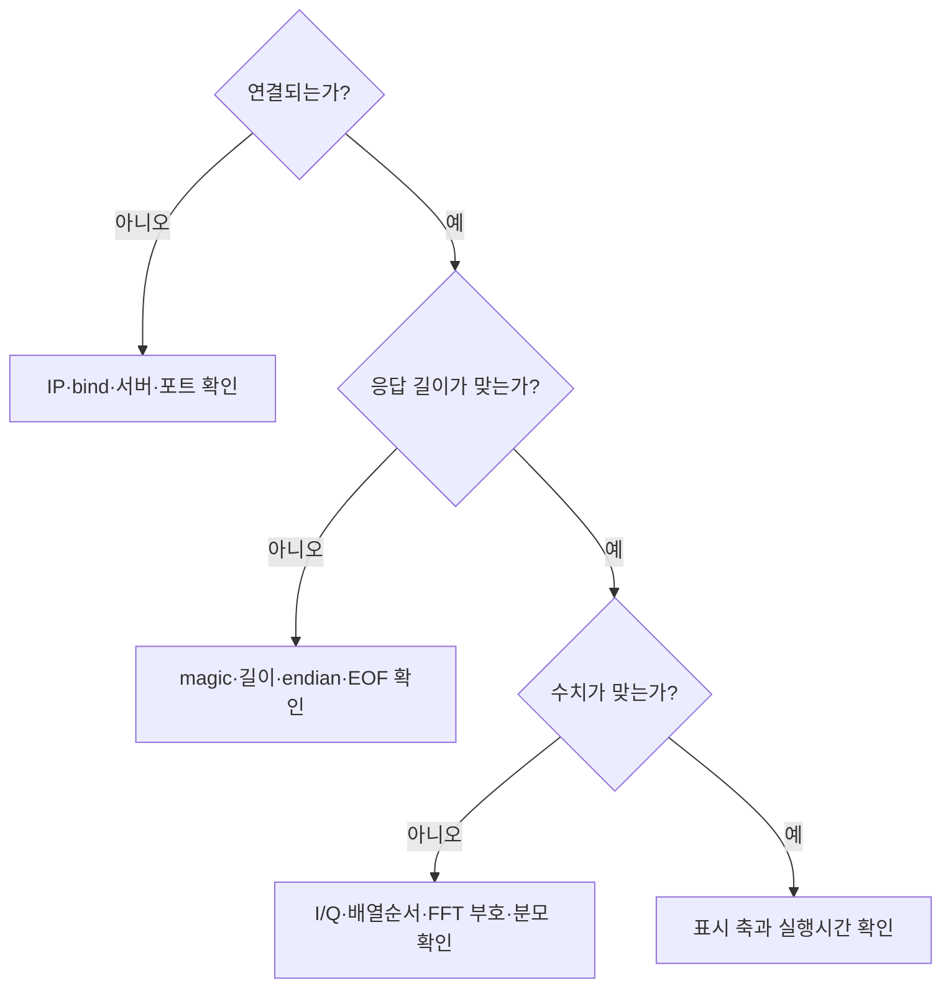

# 05. 성공뿐 아니라 실패를 설명하는 검증 방법

## 1. 실행된 것과 맞는 것을 구분

서버가 종료되지 않았다는 사실만으로 FFT가 맞다고 할 수 없습니다. 반대로 그래프가 그럴듯해도 I/Q 순서와 주파수 부호가 틀릴 수 있습니다. 입력·통신·수식·표시의 계층별로 별도 기대값을 둡니다.

| 계층 | 시험 | 기대 결과 | 잡는 오류 |
|---|---|---|---|
| 수학 | +3kHz A1 / -6kHz A0.5 | 주파수·진폭·전력 일치 | 부호/scaling/IQ swap |
| 수학 | N=32 무작위 IQ와 정의식 DFT | PSD 최대오차 <1e-12 | FFT butterfly 오류 |
| 통신 | 3바이트씩 나눠 보내기 | 완전한 응답 | recv 1회 가정 |
| 통신 | 두 프레임을 이어 보내기 | seq 11,12 응답 | 경계 혼동 |
| 방어 | 잘못된 M/N/Fs/길이/magic/NaN | 해당 연결 종료 | 메모리 범위/잘못된 값 |
| 복구 | 헤더/본문 중간 종료 | 다음 연결에서 정상 처리 | 무한대기/프로세스 종료 |
| timeout | IQ 두 글자만 전송 | 대기 종료 후 연결 닫힘 | 불완전 프레임 대기 |

Linux/Jetson에서 저장소의 `jetson/` 폴더로 이동해 실행합니다.

```bash
mkdir -p build
g++ -std=c++11 -O2 -Wall -Wextra -Werror labs/edge_dsp/cpp/server.cpp -o build/edge_server
python3 -m unittest discover -s labs/edge_dsp/tests -v
```

시험이 스스로 별도 포트의 서버를 띄우고 종료하므로 수동으로 서버를 켤 필요가 없습니다. timeout 시험 때문에 약 5초 이상의 시간이 필요합니다. 통합시험 파일에는 테스트용 데이터 생성과 기대값 산출까지 전체 구현되어 있습니다.

## 2. 예상값·허용차·실측값

기본 coherent tone의 주파수 오차 기준은 1e-8 Hz, 진폭/전력 오차 기준은 1e-5, PSD 적분과 평균 전력 차이 기준은 1e-8입니다. 이는 **합성·bin 중심·float32 입력·double FFT 조건의 회귀 허용차**입니다. 실제 RF 주파수 정확도, ADC 잡음, oscillator ppm에 대한 장비 사양이 아닙니다.

`f0=3100`처럼 off-grid로 바꾸면 `peak_hz`는 가장 큰 FFT bin의 주파수이므로 3100과 정확히 같지 않을 수 있습니다. 기존 assert가 실패하는 것이 자동으로 버그라는 뜻은 아닙니다. 이 실험은 입력을 바꾸면서 기대값과 검증 기준도 함께 바꿔야 한다는 예시입니다.

## 3. 오류를 찾는 순서



| 증상 | 먼저 확인할 것 | 구체적 행동 |
|---|---|---|
| connection refused | 서버 미실행/잘못된 포트 | Jetson `ss -ltnp`에서 5000 확인 |
| connection timeout | IP/라우팅/방화벽 | `ip -br addr`, PC 주소와 서브넷 확인 |
| bind failed | 다른 서버 점유/없는 IP | 서버 종료 여부와 실제 IP 확인 |
| invalid payload size | 8MN 계산/uint32 순서 | Wireshark TCP 스트림 또는 헤더 출력 |
| peak 부호 반전 | Q 부호/IQ 교환 | +3kHz 16개 샘플 먼저 비교 |
| 전력 2배 | 단측 PSD 규칙 잘못 적용 | 복소 IQ 양측 PSD에서 2배 제거 |
| 진폭 N배 | FFT amplitude scaling | peak magnitude를 N으로 나눴는지 확인 |
| 수정이 안 보임 | 다른 폴더/옛 실행 파일 | `pwd`, `git log -1`, 재빌드·재시작 |
| 처리시간이 계속 증가 | 큐/출력/느린 클라이언트 | 수신·처리·표시를 분리 계측 |

## 4. 로그는 무엇을 남겨야 하나

현재 서버 stderr는 seq/M/N/input_bytes/status와 거절 이유를 남깁니다. 클라이언트 JSON은 Fs, 채널별 수치, processing_ms, roundtrip_ms, PSD를 보관합니다. 실험 결과를 다른 사람이 재현하려면 여기에 실행 환경과 commit을 함께 남깁니다.

```bash
# Jetson: 시험 실행 전에 실행 조건 기록
mkdir -p output/run-001
git rev-parse HEAD > output/run-001/commit.txt
uname -a > output/run-001/system.txt
g++ --version > output/run-001/compiler.txt
python3 --version > output/run-001/python.txt
./build/edge_server 192.168.0.50 5000 2> output/run-001/server.log
```

보고서 항목은 run_id, commit, OS, CPU/보드, compiler/options, M/N/Fs, signal/seed, 입력 포맷, 창/정규화, 측정 위치, 횟수, warm-up, median/p95, 통과/실패, 한계입니다. 현재 서버가 이 모든 항목을 자동으로 기록하는 것은 아닙니다. 위 명령과 실험 노트로 보완한 뒤 자동화 기능을 추가하세요.

## 5. 본인이 완료할 고장 실험

헤더 bytes를 32768→32767로 바꾸면 서버는 계산 전에 거절해야 합니다. Q 부호를 바꾸면 peak 부호가 뒤집혀야 합니다. timeout을 유발한 뒤 새 클라이언트가 통과해야 합니다. 각 실험에서 '내가 바꾼 한 가지 → 예상 증상 → 실제 로그 → 복구 commit'을 기록합니다.

성능 시험은 warm-up을 버리고 같은 입력을 여러 번 측정합니다. 평균 하나만 보고하지 말고 표본 수·median·p95를 적습니다. p95는 관찰된 분포의 지표일 뿐 최악시간 보장이 아닙니다. Jetson에서 `tegrastats`를 함께 보며 메모리·온도·클럭 조건을 기록합니다. GPU를 사용하지 않는 CPU 코드에 GPU 가속 성능이라고 이름 붙이지 않습니다.
