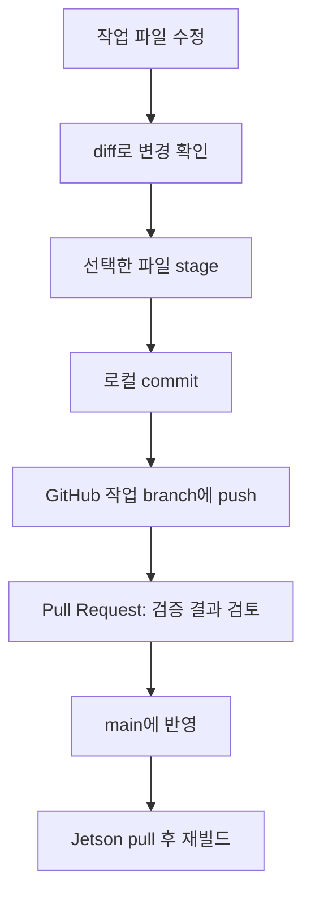

# 06. Git Bash와 GitHub Desktop으로 실험 버전 관리

> 저장소 반영 (2026-10-30): Edge DSP 교재와 코드는 저장소의 `jetson/` 폴더에 있습니다. 아래 Git 명령은 저장소 루트에서 실행하므로 파일 경로가 `jetson/`으로 시작하고, 빌드는 `jetson/` 폴더에서 합니다.

## 1. 먼저 용어를 그림과 연결

Git은 로컬 폴더의 변경 이력을 관리하는 프로그램, GitHub는 원격 저장소 서비스입니다. commit은 선택한 변경의 기록이고 branch는 작업 흐름을 가리키는 이름입니다. push는 로컬 commit을 원격에 올리고 pull은 원격 변경을 가져와 반영합니다. 저장(Ctrl+S), commit, push는 서로 다른 동작입니다.



소스 폴더를 사람마다 복제해 공용 폴더로 수동 복사하는 대신, 이 개인 학습 저장소에서는 기능별 branch를 권장합니다. `main`은 재현 가능한 기준, `lab/jaehak-fft-window`는 창 실험입니다. PC와 Jetson이 서로 다른 commit이면 실행 결과 비교가 혼란스러워집니다.

## 2. 최초 Git Bash 설정과 clone

Git for Windows를 설치하고 Git Bash를 엽니다. 아래 이름과 이메일은 본인의 값 또는 GitHub가 제공한 noreply 주소로 바꾸세요. 암호/토큰을 URL에 붙여 저장하지 않습니다. GitHub 로그인 요청은 설치된 credential manager의 브라우저 인증을 사용합니다.

```bash
git --version
git config --global user.name "Your Name"
git config --global user.email "YOUR_GITHUB_NOREPLY_EMAIL"
cd /c/Users/USER/Documents
git clone https://github.com/RobiscoI/wireless-dsp-learning-hub.git
cd wireless-dsp-learning-hub
git status
git remote -v
```

이미 clone했다면 `git clone`을 반복하지 않고 해당 폴더로 이동합니다. `USER`와 경로도 PC에 맞게 바꿉니다. Git Bash에서는 Windows 경로 `C:\Users\...`를 `/c/Users/...`로 쓸 수 있습니다.

## 3. 한 실험의 전체 과정

```bash
git switch main
git pull --ff-only
git switch -c lab/jaehak-fft-window
# VS Code에서 파일 수정, 저장, 해당 환경에서 시험
git status
git diff
git add jetson/labs/edge_dsp/cpp/server.cpp jetson/docs/edge-dsp/02-iq-fft-psd.md
git diff --staged
git commit -m "lab: document and verify FFT window normalization"
git push -u origin lab/jaehak-fft-window
```

위 commit 메시지는 실험을 실제 구현·검증한 뒤 쓰는 예시입니다. 아직 하지 않은 일을 완료했다고 적지 않습니다. `git add .`보다 파일을 지정하면 큰 IQ 결과나 비공개 자료를 실수로 올릴 가능성을 줄입니다. 시험을 Jetson에서 했다면 그 결과를 PR 본문에 적습니다.

GitHub 저장소의 **Pull requests → New pull request**에서 base=main, compare=작업 branch를 선택합니다. 문제, 바뀐 동작, 실행 명령, 수치 결과, 미검증 환경을 작성합니다. 검토 후 merge하고 Jetson에서 다음을 실행합니다.

```bash
git switch main
git pull --ff-only
git log -1 --oneline
cd jetson
g++ -std=c++11 -O2 -Wall -Wextra labs/edge_dsp/cpp/server.cpp -o build/edge_server
```

`--ff-only`가 실패하면 원격과 로컬 이력이 갈라졌다는 뜻입니다. `git status`와 `git log --oneline --graph --all -15`를 보고 본인 변경을 commit 또는 stash한 뒤 정리합니다. 공유한 이력을 강제로 덮는 force push를 기본 해결책으로 쓰지 않습니다.

## 4. 같은 일을 GitHub Desktop으로 하기

| 단계 | 화면에서 할 일 | Git 개념 |
|---|---|---|
| clone | File → Clone repository → URL에 저장소 입력 | git clone |
| 원격 반영 | Fetch origin, 필요하면 Pull origin | fetch/pull |
| 작업 시작 | Current Branch → New Branch | branch 생성 |
| 수정 확인 | Changes에서 파일과 diff 선택 | diff/stage 대상 |
| 기록 | Summary 입력 → Commit to branch | commit |
| 원격 업로드 | Publish branch 또는 Push origin | push |
| 검토 요청 | Preview/Create Pull Request | GitHub PR |
| 버전 확인 | History에서 commit 선택 | git log |

Desktop과 Git Bash는 같은 로컬 폴더를 열면 같은 `.git` 이력을 봅니다. 두 도구가 다른 저장소를 만드는 것은 아닙니다. GitHub Desktop의 편집기 열기를 VS Code로 연결하면 GUI로 수정·검토하고 명령이 필요한 때 Repository → Open in Git Bash로 넘어갈 수 있습니다. UI 이름은 설치 버전에 따라 조금 다를 수 있습니다.

## 5. 검증한 버전을 tag로 남기기

태그는 '이 commit에서 어떤 시험을 통과했다'는 표식입니다. 아래 태그는 설명용 예시이며 이번 작성으로 자동 생성하지 않았습니다.

```bash
# 실제 Jetson/MATLAB 검증을 끝낸 commit에서 실행
git tag -a edge-dsp-v0.1.0 -m "Jetson CPU TCP FFT baseline verified"
git push origin edge-dsp-v0.1.0
git show edge-dsp-v0.1.0 --stat
```

회귀가 의심되면 작업 폴더를 되돌리기 전에 별도 worktree로 과거 버전을 실행할 수 있습니다. 먼저 위 태그가 존재하는지 `git tag --list`로 확인합니다.

```bash
git worktree add ../edge-dsp-baseline edge-dsp-v0.1.0
cd ../edge-dsp-baseline/jetson
mkdir -p build
g++ -std=c++11 -O2 labs/edge_dsp/cpp/server.cpp -o build/edge_server
```

기존 폴더에서 읽기 전용 확인만 하려면 `git switch --detach edge-dsp-v0.1.0`, 변경을 계속하려면 `git switch -c fix/fft-regression`으로 branch를 만듭니다. 과거 코드를 실행해도 새 실행 파일을 재빌드해야 합니다.

## 6. Issue에 무엇을 적을까

제목 예: `FFT 창 추가 후 PSD 적분이 0.5배로 감소`. 본문은 정상 commit/문제 commit, PC·Jetson 버전, M=2,N=2048,Fs=48000, 재현 명령, 기대 전력 1, 실제값, 로그, 최소 입력, 원인 가설로 구성합니다. 저장소의 Issue 템플릿을 사용하세요. 실제 장비 주소·사용자 비밀값·큰 IQ 파일 대신 재현 가능한 합성 입력을 붙입니다.

`.gitignore`는 build/output/환경 파일을 제외합니다. 이미 추적되는 파일은 ignore만 추가해도 추적이 멈추지 않는다는 점을 기억하세요. `.gitignore`가 민감한 내용을 자동 검사해 주지는 않습니다. PR에는 소스·명세·작은 검증 요약을 올리고 대용량 측정 IQ는 별도 보관합니다.

공식 자료: [GitHub Desktop 시작](https://docs.github.com/en/desktop/overview/creating-your-first-repository-using-github-desktop), [branch 변경](https://docs.github.com/en/desktop/making-changes-in-a-branch), [Git tag](https://git-scm.com/book/en/v2/Git-Basics-Tagging).
