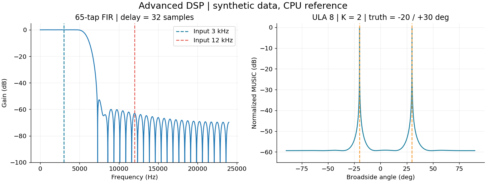
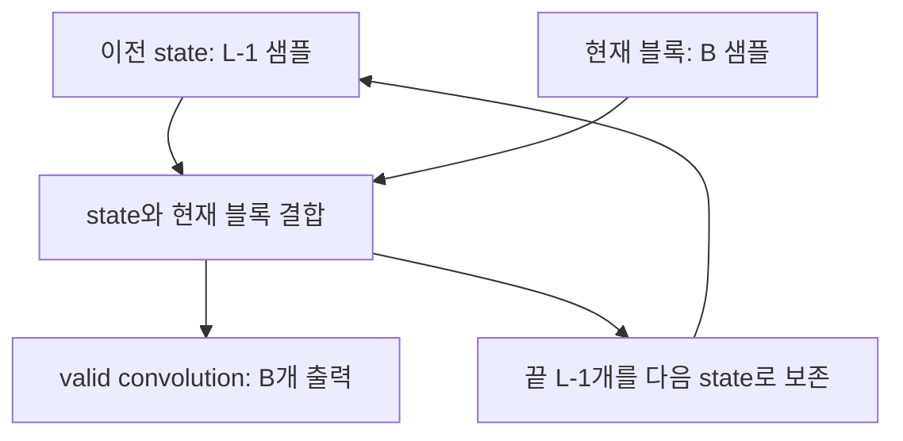

# 07. FIR·공분산·MUSIC으로 심화하기




첫 TCP 프로그램을 완주했다면 같은 입력을 더 복잡한 알고리즘에 넣습니다. 우선 파일/메모리에서 수치 검증을 한 뒤 네트워크 서비스로 옮깁니다. 제공한 `advanced_dsp.py`는 독립 실행 실험이며 C++ 서버 v1이 FIR/MUSIC 요청을 이미 지원하는 것은 아닙니다.

## 1. 블록 처리에서 FIR 상태가 필요한 이유

$$
y[n]=\sum_{k=0}^{L-1}h[k]x[n-k]
$$

L탭 필터는 현재 입력뿐 아니라 과거 L-1개 입력도 사용합니다. 2048샘플씩 잘라 보냈더라도 실제 신호 시간은 이어집니다. 매 블록에서 필터를 초기화하면 경계마다 과도응답이 반복됩니다. 따라서 계산 모듈에 state를 넘기고 끝의 L-1개를 다음 호출에 보존해야 합니다.



예제는 Fs=48kHz, L=65, cutoff=6kHz, 입력은 3kHz+12kHz입니다. 이상 저역통과 임펄스 응답에 Hamming 창을 곱하고 합을 1로 맞춰 DC gain을 보존합니다. 대칭 홀수 탭 FIR의 군지연은 `(L-1)/2=32`샘플, 약 0.6667ms입니다. cutoff는 이상 sinc 설계 파라미터이며 실제 통과/저지대역 경계와 감쇠를 보장하는 완성 사양은 아닙니다. 주파수 응답을 측정해 별도 사양을 정해야 합니다.

전체 입력을 한 번에 convolve한 결과와 127샘플씩 나눠 처리한 결과의 최대차이를 비교합니다. 블록 길이를 필터 길이·FFT 길이와 다르게 잡아 경계 처리를 드러냅니다. 상태를 0으로 매번 초기화하도록 바꾸고 경계 오차가 생기는지 확인하세요.

## 2. 배열 모델을 행렬로 쓰기

$$
X=AS+W,\quad X\in\mathbb C^{M\times N},\quad A\in\mathbb C^{M\times K}
$$

M은 센서, N은 snapshot, K는 신호 수입니다. 센서 간 위상차가 A에 들어 있습니다. 이번 입문 예제는 ULA 8소자, 간격 d=λ/2, broadside 기준 θ입니다.

$$
a_m(\theta)=e^{j2\pi m(d/\lambda)\sin\theta},\quad m=0,\dots,M-1
$$

이 부호는 수신 모델과 일치시켜야 합니다. 문헌의 반대 부호도 모델 전체가 일관되면 가능합니다. UCA로 확장할 때는 위치 벡터를 사용해 `a_m=exp(j k r_m·u(θ))`로 바꾸고, 0도 방향·반시계/시계 방향·배열 좌표를 명시합니다. 기존 프로젝트의 소자 수나 반경을 이 예제의 필수 조건으로 가져오지 않습니다.

## 3. 공분산에서 noise subspace까지

여기서는 평균을 빼지 않는 sample second moment를 씁니다.

$$
\hat R=\frac{1}{N}XX^H
$$

평균 0, 독립 소스, 공간 백색 잡음이면 이론적으로 `R=A Rs Aᴴ+σ²I`입니다. A의 rank가 K이고 Rs가 full rank라면 신호 공간 차원은 K, 나머지 M-K개 고유벡터가 잡음 공간을 이룹니다. 단순히 송신기 수가 K라고 해서 항상 rank K인 것은 아닙니다. 완전히 상관된 다중경로는 유효 rank를 줄일 수 있습니다.

`numpy.linalg.eigh`는 Hermitian 행렬용이며 고유값을 작은 순서로 돌려줍니다. 예제의 `En=vectors[:,:M-K]`는 그 순서를 전제로 합니다. MATLAB `eig` 결과를 사용할 때는 스스로 고유값 정렬과 벡터 재배치를 확인해야 합니다.

$$
P_{MUSIC}(\theta)=\frac{1}{\|E_n^H a(\theta)\|^2}
$$

참 방향의 steering vector가 신호 공간 안에 있으면 noise subspace와 직교하므로 분모가 작아집니다. 실제 데이터에서는 유한 snapshot·잡음·모델 불일치 때문에 정확히 0이 되지 않습니다. 예제는 분모 바닥값을 넣고 국소 peak를 고른 뒤 최소 2° 간격으로 두 개를 선택합니다. 가장 큰 격자점 두 개만 고르면 같은 peak 주변 두 점이 선택될 수 있습니다.

## 4. 전체 심화 코드 실행

```bash
# Jetson: 배포판 NumPy를 선택하여 시스템 Python과의 호환성을 우선 확인
sudo apt-get install python3-numpy
python3 -c "import numpy; print(numpy.__version__)"
python3 labs/edge_dsp/python/advanced_dsp.py
```

PC Python 환경에서 실행하려면 본인 가상환경에 NumPy를 설치한 뒤 같은 파일을 실행합니다. 최신 NumPy의 Python 요구사항을 구형 Jetson Python에 그대로 적용하지 않습니다.

전체 코드: [advanced_dsp.py](../../labs/edge_dsp/python/advanced_dsp.py). 기본값은 M=8,N=4096,K=2, 방향 -20°와 30°, 난수 seed 42, 소스별 전력 1, 잡음 전력 0.01입니다. 합성 데이터가 white noise·독립 소스 가정을 만족하는지부터 읽으세요. K는 추정값이 아니라 예제에서 알고 주는 값입니다.

## 5. FFT 전처리를 했는데 공분산이 그대로인 이유

모든 snapshot 축에 unitary FFT F를 적용하고 모든 bin을 유지하면 `Y=XF`, `FFᴴ=I`이므로 다음이 성립합니다.

$$
\frac{YY^H}{N}=\frac{XFF^HX^H}{N}=\frac{XX^H}{N}
$$

즉, 모든 bin의 unitary FFT만으로 MUSIC 공간 공분산이 좋아지는 것은 아닙니다. 특정 공통 주파수 대역을 선택하거나 시간 평균 방법을 바꿀 때 다른 효과가 생깁니다. 채널마다 서로 다른 peak bin을 선택하면 같은 신호의 공간 위상 관계를 깨뜨릴 수 있습니다. 한 bin의 M×1 벡터만으로 만든 outer product는 rank≤1이라 다중 신호 subspace를 충분히 표현하지 못합니다.

샘플마다 크기를 1로 만드는 phase-only 변환은 비선형이며 진폭·잡음 통계를 바꿉니다. amplitude+phase manifold와 측정 IQ의 처리 가정을 일치시키고 전역 scalar 정규화, 채널 gain 보정, phase-only 변환을 서로 구분해야 합니다.

## 6. 실패를 만들어 이해하는 확장 실험

| 변화 | 왜 하는가 | 관찰/판정 |
|---|---|---|
| N=4096→256 | 표본 수 영향 | 여러 seed의 DOA RMSE·실패율 |
| noise 배율 0.1→1 | 신호/잡음 분리 감소 | 고유값 간격과 peak 폭 |
| 각도 -20/30→10/12 | 가까운 신호 분해 | 두 국소 peak가 유지되는지 |
| 두 소스를 같은 파형으로 | coherent multipath | rank와 K 가정이 깨지는지 |
| 한 센서 위상 +10° | calibration 오차 | bias와 peak 저하 |
| 간격 d=λ | grating lobe | 유일한 각도 해석이 어려워지는지 |

일반 ULA 공간 평활화는 이동 불변 부분배열 구조를 이용합니다. UCA에 ULA용 평활화나 단순 reversal 기반 FBA를 그대로 적용하지 않습니다. UCA는 배열 대칭·센서 pairing·phase-mode 변환·보정 조건을 별도로 검토합니다. 센서 수가 같다는 이유만으로 ULA와 UCA를 교환할 수 없습니다.

다음 구현 목표는 C++ 서버에 `algorithm`과 명시적 배열 geometry를 추가하고 버전을 IQ02 등으로 올리는 것입니다. 먼저 Python 기준 출력과 covariance/eigenvalue/DOA를 단계별 비교한 뒤 peak만 전송합니다. 현재 v1은 FFT·PSD 서버입니다.

공식 함수 자료: [NumPy eigh](https://numpy.org/doc/stable/reference/generated/numpy.linalg.eigh.html), [MathWorks Beamforming Overview](https://www.mathworks.com/help/phased/ug/beamforming-concepts.html).
