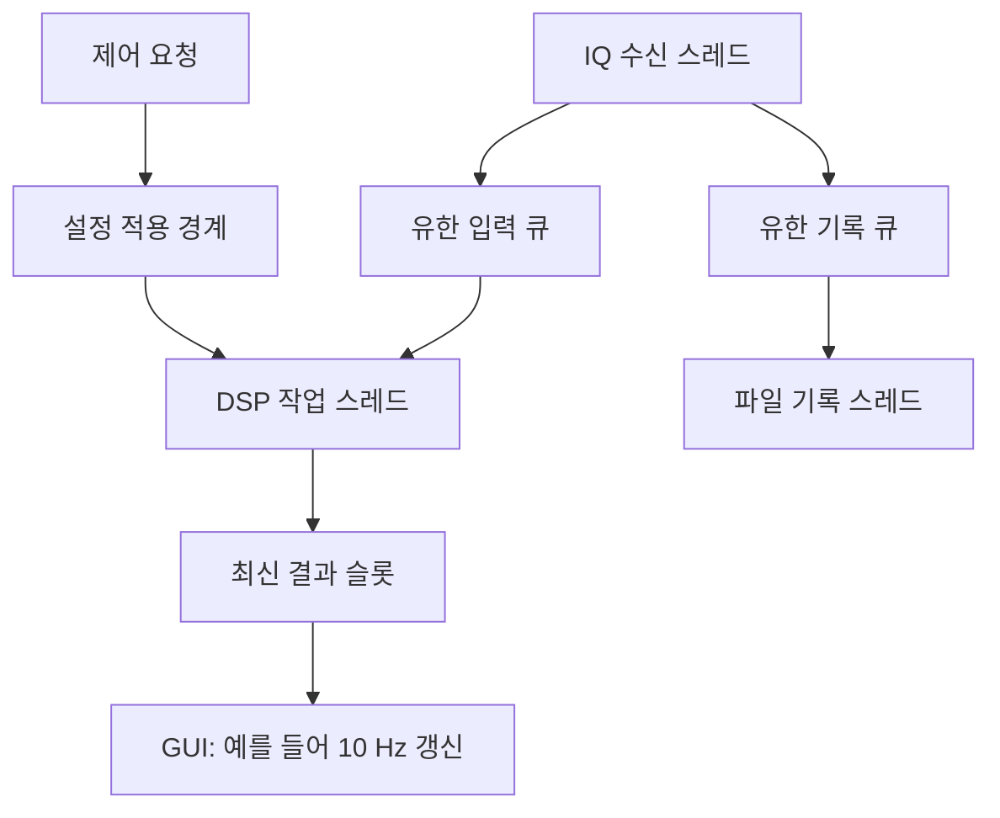

# 08. 연속 스트리밍·스레드·GPU 최적화 설계

## 1. 현재 데모에서 실시간 시스템으로 넘어가는 경계

현재 v1은 한 프레임을 보내고 응답을 기다리는 요청/응답 프로그램입니다. 서버는 클라이언트 하나를 순차 처리하며, bounded queue나 DMA가 없습니다. 파일 생성 속도와 실제 ADC의 연속 sample clock도 구분해야 합니다. 첫 성공을 곧 '실시간 SDR 완성'으로 부르지 않습니다.

연속 IQ를 다룰 때는 신호의 발생률이 시스템의 서비스율보다 낮아야 장기적으로 backlog가 쌓이지 않습니다. 평균이 충분해도 순간적인 지연이 있으므로 큐 용량, 유실 정책, 지연 상한을 함께 정해야 합니다.

## 2. 먼저 데이터율을 손으로 계산

$$
R_{bytes}=F_s\times M\times2\times B
$$

B는 I 또는 Q 한 값의 바이트 수입니다. float32는 B=4, int16은 B=2입니다.

| 설정 | 원시 IQ 데이터율 | 의미 |
|---|---:|---|
| 48kS/s, M=2, float32 IQ | 768000 B/s = 0.768 MB/s = 6.144 Mb/s | 첫 실습 |
| 1MS/s, M=2, float32 IQ | 16 MB/s = 128 Mb/s | 100Mb/s 링크 payload 용량 초과 |
| 1MS/s, M=10, float32 IQ | 80 MB/s = 640 Mb/s | Gigabit에서도 overhead/역방향 응답/CPU 고려 |

이는 payload만의 십진 단위 계산이며 Ethernet/IP/TCP 헤더, 재전송, JSON 응답은 별도입니다. 1Gb/s 포트가 있다고 응용이 언제나 125MB/s를 처리하는 것은 아닙니다. Fs=48k,N=2048이면 초당 약 23.4375프레임입니다. 요청/응답 전체 처리시간이 매번 42.67ms보다 길면 실제 연속 입력을 모두 처리할 수 없습니다. 여유율도 필요합니다.

## 3. 소켓 수보다 역할과 큐를 먼저 결정

모든 스레드가 같은 socket을 동시에 읽으면 프레임 경계의 소유권이 불분명해집니다. 수신은 한 곳이 담당하고 decode된 프레임을 큐로 전달합니다. DSP 결과는 GUI 표시와 저장이 각자 소비하도록 합니다. GUI가 느리다고 수신 thread에서 그림을 그리며 대기하지 않습니다.

| 흐름 | 보존 정책 | 큐가 찼을 때 |
|---|---|---|
| GUI 표시 | 최신 값 우선 | 이전 표시 결과 교체, 교체 횟수 기록 |
| 연속 기록 | 모두 보존 목표 | upstream backpressure/중단/명시적 drop 중 선택 |
| 통계/복조 | 연속성 중요 | gap 표시, 상태 재동기화 여부 결정 |
| 제어 | 응답·순서 중요 | 별도 작은 큐, 적용 seq 응답 |

예를 들어 8프레임 입력 큐는 payload만 약 256KiB지만, 포화 시 가장 오래된 데이터의 대기 시간은 약 8×42.67ms 수준까지 늘 수 있습니다. 큐를 크게 만드는 것은 잠깐의 지연을 흡수하지만 지속적인 처리율 부족을 해결하지 못합니다. 실제 buffer 복사본·double 변환·JSON 문자열·OS socket buffer 메모리도 포함해야 합니다.

## 4. UDP는 언제 검토하나

TCP는 순서·재전송을 제공하고 손실 시 뒤 데이터가 기다릴 수 있습니다. UDP는 응용이 seq/gap/reorder/timeout을 책임져야 합니다. 32768바이트 IQ 프레임을 거대한 UDP datagram 하나로 보내지 않고, 경로 MTU를 고려한 조각 크기와 frame_id/fragment_index/fragment_count를 설계합니다. 예시 payload 1200바이트는 보수적 출발값이지 모든 경로에서 검증된 고정값이 아닙니다.

초기에는 TCP 한 데이터 채널로 계약을 완성합니다. 연속 IQ, PSD, 제어가 서로 대기시키는 것이 관찰되면 데이터/제어 소켓을 분리할 이유가 생깁니다. 기능마다 무조건 포트를 늘리는 대신 QoS·처리율·연속성 요구로 결정합니다. UDP 코드와 멀티스레드 서버는 향후 구현 단계이며 현재 제공 코드의 기능이 아닙니다.

## 5. CPU 최적화에서 GPU까지

1. 같은 입력에서 처리 구간을 분리합니다: 바이트 복원, FFT, PSD, JSON, send, PC 표시.
2. vector 재할당·반복 문자열 생성·복사를 먼저 확인합니다.
3. 직접 FFT를 KISS FFT 또는 FFTW로 대체하되 normalization과 complex layout을 검증합니다.
4. FFT plan과 버퍼는 루프 밖에서 재사용하고 warm-up 뒤 측정합니다.
5. GPU는 배치 수를 늘렸을 때 의미가 있는지 확인합니다. 작은 2048점 FFT 한 번은 준비·동기화 비용이 더 클 수 있습니다.

$$
T_{GPU,total}=T_{prepare}+T_{copy/sync}+T_{kernel}+T_{result}
$$

Jetson은 CPU/GPU가 시스템 메모리를 공유하는 구조지만 모든 데이터 접근·동기화 비용이 사라지는 것은 아닙니다. GPU event로 kernel 시간, CPU monotonic clock으로 전체 호출 시간을 따로 측정하세요. 현재 `processing_ms`를 cuFFT kernel 시간과 직접 비교하지 않습니다.

cuFFT는 오픈소스 FFT 라이브러리와 다르게 NVIDIA 제공 라이브러리입니다. Nano의 실제 CUDA 버전과 맞는 문서를 사용해야 하며 최신 CUDA 13 문서의 기능을 JetPack 4에서 지원한다고 가정하지 않습니다. 설치된 `nvcc --version`을 기록하고 해당 버전 archived guide로 이동합니다.

## 6. 최적화 통과 기준

정확도 허용차, 입력/환경 고정, warm-up/반복수, median/p95, 처리량, 메모리, 온도·클럭, 전체 지연을 함께 표로 냅니다. 속도만 빨라지고 데이터 drop이 늘면 동일 기능 비교가 아닙니다. 변경 한 개마다 commit을 만들고 기준선과 비교합니다.

공식 자료: [KISS FFT](https://github.com/mborgerding/kissfft), [FFTW](https://www.fftw.org/), [cuFFT 안내](https://docs.nvidia.com/cuda/cufft/index.html). 버전·라이선스 검토는 10장을 따릅니다.
