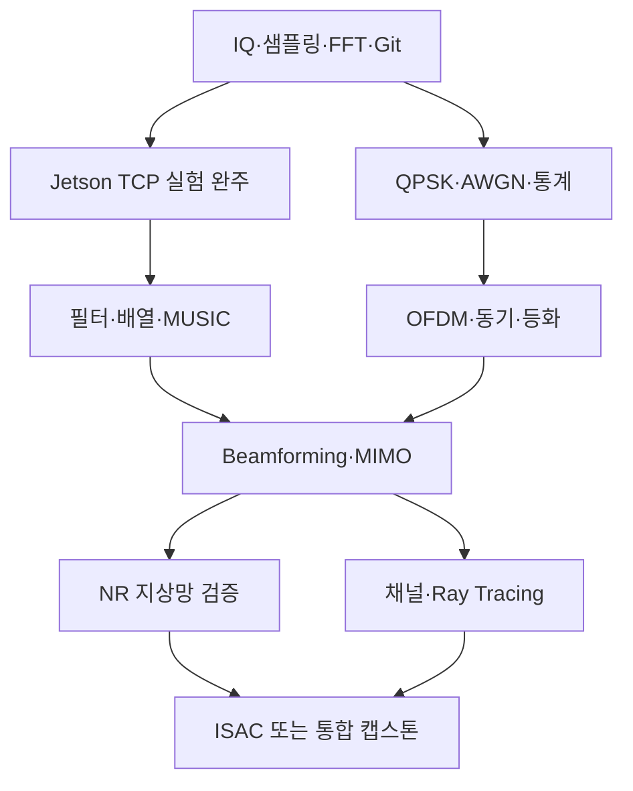

# 09. 기존 24주 과정을 기초→심화 개발 과정으로 연결하기

이 장은 새 Edge DSP 실습과 기존 MATLAB 과정의 연결 지도입니다. 기존 72세션을 없애지 않고 선행조건과 완료 기준을 보강합니다. 날짜·120분·150분 등의 기존 표기는 최초 편성 기록으로 읽고, 실제 학습은 아래 gate로 판단합니다. 각 단계마다 요구사항→모델→코드→검증→실패 분석→기록의 동일한 개발 과정을 반복합니다.

## 1. 전체 의존 관계



## 2. 단계별로 실제 무엇을 설계할까

| 단계 | 목적과 입력 | 설계/코드 | 검증 산출물 |
|---|---|---|---|
| A 기초 DSP | Fs·N·tone·noise | 샘플링, FFT, 창, PSD, FIR | 진폭/전력/지연 표, aliasing 그림 |
| B Edge 실험 | A의 IQ 행렬 | byte 계약, TCP, C++ FFT, PC 비교 | 통합시험·실행 로그·commit |
| C 변조 | bit와 Eb/N0 | QPSK mapping, AWGN, hard decision | 오류 수/비트 수/BER/구간 |
| D 배열 | geometry와 source model | steering, R, beamforming, MUSIC | 패턴·고유값·DOA RMSE |
| E OFDM | QPSK grid와 channel | IFFT/CP/channel/FFT/ZF, 이후 CFO/timing | EVM·BER·CP 실패 실험 |
| F MIMO/NR | 안테나/채널/표준 파라미터 | 교육 MIMO와 공식 NR 예제 비교 | 제품 의존성·BLER/throughput |
| G RT 채널 | geometry/material/frequency | 경로 손실·지연·방향을 채널로 변환 | 에너지·지연·좌표 검증 |
| H ISAC | waveform/target/delay/Doppler | 통신과 sensing 지표 분리 | range-Doppler map+EVM |
| I 전달 | 대표 시나리오 한 개 | API·GUI·실험 자동화·README | 새 폴더에서 재실행 가능한 결과 |

## 3. QPSK·AWGN: 잡음을 넣기 전에 전력을 정한다

QPSK 심볼은 `(±1±j)/sqrt(2)`여서 평균 심볼 에너지 Es=1입니다. 한 심볼이 2비트이므로 무부호 조건에서 Eb=Es/2입니다. γb=Eb/N0라면 복소 잡음 전력 N0=1/(2γb), I와 Q 각각의 분산은 N0/2입니다.

$$
s=\frac{(1-2b_I)+j(1-2b_Q)}{\sqrt2},\quad
w=\sqrt{N_0/2}(u+jv),\quad
P_b=\tfrac12\operatorname{erfc}(\sqrt{E_b/N_0})
$$

전체 코드 [qpsk_ofdm_reference.m](../../labs/edge_dsp/matlab/qpsk_ofdm_reference.m)를 실행합니다.

```matlab
addpath('labs/edge_dsp/matlab');
report = qpsk_ofdm_reference();
```

Eb/N0=0,2,4,6,8dB에서 이론 BER는 약 0.07865,0.03751,0.01250,0.002388,0.0001909입니다. 코드의 점당 200000비트에서 실제 오류 수는 난수에 따라 변합니다. 다음 확장은 최소 100오류 또는 최대 비트 수까지 반복하는 정지 조건과 신뢰구간입니다. 오류 0개를 BER=0 보장으로 해석하지 않고 독립 Bernoulli 가정에서 대략 3/N의 95% 상한을 적습니다.

Wilson 구간을 직접 구현하려면 오류 k, 비트 n, p=k/n, z=1.96에 대해 center=(p+z²/(2n))/(1+z²/n), half=z*sqrt(p(1-p)/n+z²/(4n²))/(1+z²/n)을 계산합니다. 동일 seed 한 번의 곡선이 '일반 성능'인 것은 아니므로 여러 seed와 표본 수를 함께 보고합니다.

## 4. OFDM: 왜 CP를 넣고 한 탭으로 나눌까

주파수 심볼 X를 IFFT하면 N개 시간 샘플이 됩니다. 끝 Ncp개를 앞에 복사하면 CP 구간이 생깁니다. 채널의 최대 지연이 CP 안에 들어오고 동기가 맞으면, CP를 제거한 구간에서 선형 컨볼루션이 N점 원형 컨볼루션처럼 보여 `Y[k]=H[k]X[k]+W[k]`가 됩니다. 그래서 주파수별 한 번의 나눗셈으로 등화할 수 있습니다.

제공 코드는 Nfft=64,Ncp=16,Nsym=100, 채널 h=[1,0,0.3exp(j0.4)]입니다. 최대 지연 2샘플이 CP16보다 짧고 채널을 완전히 안다고 가정하므로 무잡음 EVM<1e-12를 기준으로 둡니다. 이는 동기/추정이 완벽한 교육 모델입니다.

다음은 한 번에 하나씩 넣습니다: AWGN → pilot 기반 채널 추정 → 정수 timing offset → 분수 CFO → CP 부족. CFO는 `exp(j2π ε n/Nfft)`를 곱해 만듭니다. 예시 ε=0.1이면 부반송파 간격의 10% 오프셋입니다. timing의 기준점, noise를 넣는 위치, FFT scaling을 문서에 남깁니다. EVM은 `sqrt(sum(|S_hat-S|²)/sum(|S|²))`이며 백분율은 ×100입니다.

## 5. NR로 갈 때 교육용 OFDM에 없는 것

NR에는 numerology, resource grid, reference signal, 채널 부호화, rate matching, 동기, 채널 추정, HARQ 등의 구체 절차가 있습니다. OFDM 그래프가 나온다는 이유로 NR PDSCH가 구현됐다고 쓰지 않습니다. MathWorks 공식 NR PDSCH Throughput 예제를 열어 필요한 5G Toolbox 등 제품 목록과 릴리스 호환성을 먼저 확인합니다.

첫 설계표에는 carrier/SCS/RB 수, antenna layers, modulation/coding, channel, delay spread, Doppler, SNR 정의, slot 수, seed, KPI를 적습니다. 예제 기본값으로 한 번 실행한 후 SNR 하나만 바꿔 BLER/throughput 변화를 확인하고, 이후 안테나/빔포밍을 연결합니다. 라이선스가 없다면 공식 예제 구조를 읽고 교육용 OFDM과 블록 대응표를 만드는 것으로 진행할 수 있습니다.

## 6. Ray Tracing: 경로 목록을 무선 채널로 바꾸기

합성 다중경로는 `h(t)=Σ α_l δ(t-τ_l)`로 시작합니다. α는 복소 gain, τ는 지연입니다. `power_dB`를 복소 진폭으로 바꿀 때는 `10^(power_dB/20)`인지, 이미 amplitude_dB인지 정의를 확인합니다. 위상에 carrier propagation phase가 이미 들어 있는 경로 자료에 다시 `exp(-j2πfcτ)`를 곱하면 이중 적용이 됩니다.

첫 교환 포맷은 path_id, delay_s, gain_real, gain_imag, AoA/AoD_deg, 좌표계, carrier_hz, normalization입니다. 예시 τ=[0,1.5,4]μs, 상대 power=[0,-6,-10]dB를 만든 뒤, sample rate에서 delay가 정수/분수인지 확인합니다. 분수 지연을 단순 반올림한 모델과 보간 필터 모델의 차이를 비교하세요.

Sionna/RT는 호환되는 PC/서버에서 먼저 조사·실행하고 작은 경로 목록/채널 행렬을 MATLAB/Jetson으로 가져오는 구조가 적절합니다. Nano 2GB에 현재 최신 Sionna가 설치된다고 가정하지 않습니다. 채널 버전과 geometry 파일 hash도 실험 입력입니다.

## 7. ISAC: 통신과 센싱의 지표를 나눈다

단일 표적 모델은 delay τ=2R/c, Doppler fd=2v/λ에서 시작합니다. 단일 정적 표적, 알려진 송신 grid, 무잡음 조건으로 range peak를 먼저 검증하고 이후 off-grid/noise/clutter/multiple target을 추가합니다. 단순 OFDM sensing에서 대역폭 B에 따른 거리 분해능은 대략 c/(2B), 관측시간 T에 따른 Doppler 분해능은 약 1/T입니다. 이는 특정 파형/처리 가정의 근사값이며 range ambiguity, CP, sampling, window에 따른 제약도 별도로 정합니다.

예를 들어 B=20MHz면 c/(2B)≈7.49m입니다. 0.1m 단위 축을 그려도 물리적 분해능이 0.1m가 되는 것은 아닙니다. 통신 EVM/BER와 센싱 거리·속도 오차/검출률을 별도 panel로 표시합니다. 공식 ISAC 예제와 교육 모델에서 같은 블록과 빠진 블록을 표시한 뒤 최종 캡스톤을 선택합니다.

## 8. 최종 캡스톤을 완료하는 기준

문제 한 문장, 입력 스펙, 구조도, 전체 소스, 실행 명령, 정상·실패 시험, 결과 표·그림, 실행 환경·commit, 한계·다음 실험을 묶습니다. 예: '합성 2채널 IQ를 PC에서 Jetson으로 보내 CPU FFT·PSD를 계산하고, MATLAB 결과와 일치함을 검증한다'. 이 결과가 확보되면 '실시간 상태 FIR' 또는 '배열 MUSIC 서비스' 중 하나만 다음 기능으로 추가합니다.

기존 로드맵의 NTN은 선택 과정으로 유지합니다. 실시간 gNB·RF 송수신에는 별도 장비/의존성 검토가 필요하므로 추가 보드 없는 첫 실습과 혼합하지 않습니다.

공식 읽기: [NR PDSCH](https://www.mathworks.com/help/5g/ug/nr-pdsch-throughput.html), [RayTracingChannel](https://www.mathworks.com/help/comm/ref/comm.raytracingchannel-system-object.html), [ISAC 예제](https://www.mathworks.com/help/5g/ug/integrated-sensing-and-communication-using-5g-waveform.html), [Sionna](https://github.com/NVlabs/sionna).
